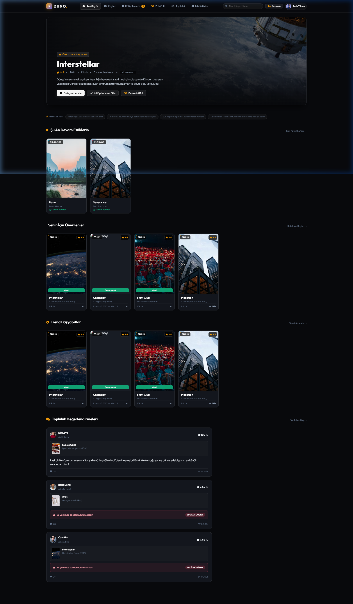
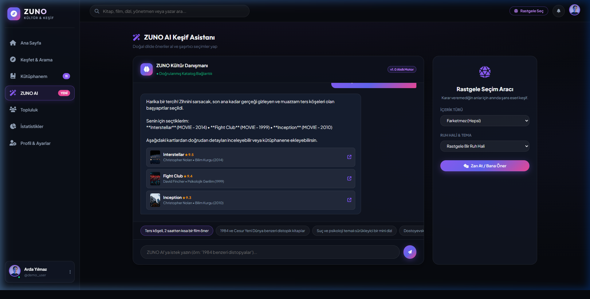
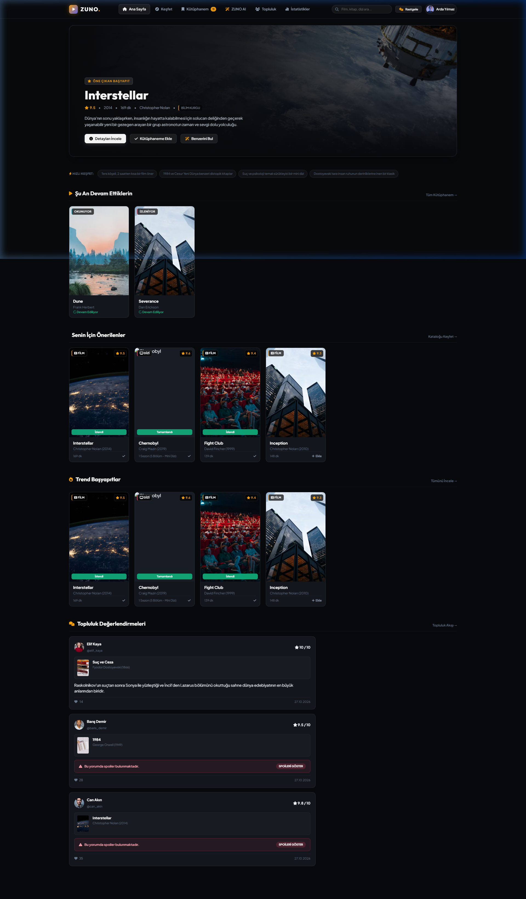
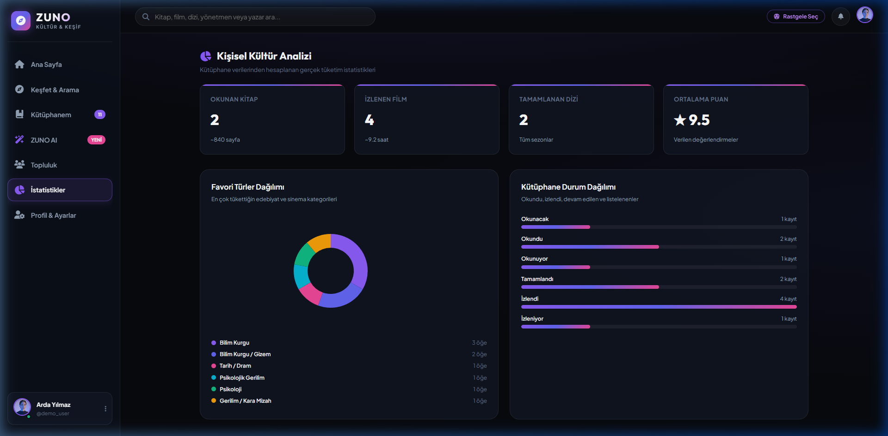

# ZUNO — Kişisel Kültür ve Keşif Platformu
> **OKU • İZLE • KEŞFET • PAYLAŞ**



[](https://python.org)
[](https://flask.palletsprojects.com/)
[](https://sqlite.org)
[](LICENSE)

---

## 📸 Ekran Görüntüleri

| Ana Sayfa & Keşif | ZUNO AI Doğal Dil Danışmanı |
|:---:|:---:|
|  |  |

| Katalog & Filtreler | Kültür İstatistikleri |
|:---:|:---:|
|  |  |

---

## 📌 Proje Tanımı
**ZUNO**; kullanıcıların okudukları kitapları, izledikleri film ve dizileri tek bir yerde kaydedebildiği, puanlayabildiği, yorumlayabildiği ve arkadaşlarıyla paylaşabildiği yapay zekâ destekli bir kişisel kültür platformudur.

*Goodreads*, *Letterboxd* ve *Serializd* deneyimlerini tek ve modern bir arayüzde birleştirir.

**Temel Fikir:** Kullanıcının yalnızca geçmişte tükettiği içerikleri kaydetmesi değil; kendi zevklerini tanıması, okuma/izleme alışkanlıklarını grafiklerle görmesi ve ZUNO AI ile yeni hikâyeler keşfetmesidir.

---

## ✨ Temel Özellikler

### 1. 📚🎬📺 Tek Çatıda Kültür Arşivi
- Kitap, film ve dizileri tek bir arayüzden arayın ve kütüphanenize ekleyin.
- **Kitap Durumları:** `Okunacak`, `Okunuyor`, `Okundu`, `Yarım Bırakıldı`
- **Film Durumları:** `İzlenecek`, `İzlendi`
- **Dizi Durumları:** `İzlenecek`, `İzleniyor`, `Tamamlandı`, `Ara Verildi`, `Bırakıldı`
- 10 üzerinden kişisel puanlama ve özel not tutma.

### 2. 🛡️ Spoiler Korumalı Sosyal Yorum Sistemi
- Kullanıcılar yorum yazarken **"⚠️ Bu yorum spoiler içeriyor"** seçeneğini işaretleyebilir.
- Spoiler içeren yorumlar varsayılan olarak buzlu kalkanla gizlenir; kullanıcı yalnızca dilerse **"Spoileri Göster"** butonuna basarak metni açabilir.
- Yorumları beğenme ve etkileşim.

### 3. 🤖 ZUNO AI & Doğal Dille Keşif
- **Sohbet Tabanlı Danışman:** *"Ters köşeli, 2 saatten kısa bir film öner"*, *"1984 ve Cesur Yeni Dünya benzeri distopik kitaplar"* gibi doğal dilde yazılan istekleri anlar ve katalogdaki doğrulanmış içeriklerle eşleştirir.
- **Rastgele Seçim Aracı (Surprise Me):** Karar veremediğiniz anlarda tür (kitap/film/dizi) ve ruh hali (zihin açıcı, gerilim, felsefi) seçerek tek tıkla şaşırtıcı içerik bulur.
- **Kişiselleştirilmiş Öneri Motoru:** Geçmiş puanlarınıza ve favori türlerinize göre özel seçkiler.

### 4. 👥 Sosyal Topluluk ve "Ortak Zevkler"
- Diğer kültür meraklılarını takip edebilme.
- Canlı topluluk hareketleri ve arkadaş akışı.
- **Ortak Zevk Analizi (Taste Match):** Herhangi bir kullanıcının profiliyle kendi kütüphanenizi karşılaştırıp **zevk uyum yüzdesini (%)** ve ortak sevdiğiniz eserleri anında görün!

### 5. 📊 Gerçek Zamanlı İstatistikler & Analiz
- Okunan kitap sayısı ve tahmini okunan sayfa hesabı.
- İzlenen film sayısı ve toplam sinema saati.
- Tamamlanan dizi sezonları.
- Favori türlerin dinamik pasta ve durum dağılım grafikleri.

---

## 🏗️ Mimari ve Teknoloji Seçimi

```
ZUNO/
├── app.py                # Flask REST API Sunucusu & Sayfa Yönlendirici
├── database.py           # SQLite Veritabanı Modeli & Zengin Başlangıç Tohumu (Seed)
├── requirements.txt      # Gerekli Python Paketleri
├── .gitignore            # Git Yoksayma Dosyası
├── README.md             # Proje Dokümantasyonu
├── templates/
│   └── index.html        # Tek Sayfa Uygulaması (SPA) Ana Şablonu
└── static/
    ├── css/
    │   └── style.css     # Antrasit / Koyu Lacivert & Mor Neon Tasarım Sistemi
    └── js/
        ├── api.js        # REST API Servis Katmanı & Çevrimdışı Yedekleme
        ├── ai_agent.js   # ZUNO AI Doğal Dil Analizcisi
        └── app.js        # SPA Router, Modallar, Spoiler Maskesi & Grafikler
```

| Katman | Teknoloji | Görevi |
|---|---|---|
| **Arayüz (Frontend)** | Modern HTML5 + Vanilla CSS + ES6 JS | Hızlı, şık, mobil uyumlu, harici framework bağımlılığı olmadan çalışan Single Page App |
| **Tasarım Dili** | Glassmorphism, Deep Obsidian, Mor Glow | Modern estetik, göz yormayan karanlık mod, mikro animasyonlar |
| **Sunucu (Backend)** | Python 3 + Flask | RESTful API uç noktaları, iş kuralları ve veri akışı |
| **Veritabanı** | SQLite (`zuno.db`) | Kullanıcılar, içerikler, kütüphane, yorumlar, beğeniler ve takip ilişkileri |

---

## 🚀 Kurulum ve Çalıştırma

### 1. Depoyu İndirin
```bash
git clone https://github.com/KULLANICI_ADINIZ/ZUNO.git
cd ZUNO
```

### 2. Gerekli Paketleri Yükleyin
*(Python 3.10 veya üzeri önerilir)*
```bash
pip install -r requirements.txt
```

### 3. Veritabanını Başlatın ve Tohumlayın
```bash
python database.py
```
> Bu komut `zuno.db` veritabanını oluşturur; 16'dan fazla seçkin kitap, film ve diziyi, demo kullanıcılarını ve örnek spoiler korumalı incelemeleri yükler.

### 4. Sunucuyu Başlatın
```bash
python app.py
```

Tarayıcınızı açın ve şu adrese gidin:  
👉 **`http://localhost:5000`**

---

## 📡 REST API Uç Noktaları

| Metot | Adres | Amaç |
|---|---|---|
| `GET` | `/api/auth/me` | Giriş yapan kullanıcının profil bilgilerini getirir |
| `POST` | `/api/auth/login` | Kullanıcı girişi |
| `POST` | `/api/auth/register` | Yeni hesap oluşturma |
| `GET` | `/api/contents` | Kitap/film/dizi katalog arama ve filtreleme (`?type=`, `?category=`, `?search=`) |
| `GET` | `/api/contents/<id>` | İçerik detayı, kullanıcı puanı ve spoiler korumalı yorumlar |
| `GET` | `/api/library` | Kullanıcının kütüphanesini listeler |
| `POST` | `/api/library` | Kütüphaneye içerik ekler veya durumu günceller |
| `PATCH` | `/api/library/<id>` | Kütüphane kaydının durumunu, puanını veya notunu günceller |
| `DELETE` | `/api/library/<id>` | İçeriği kütüphaneden kaldırır |
| `POST` | `/api/reviews` | Puan ve (isteğe bağlı spoiler korumalı) yorum yazar |
| `POST` | `/api/reviews/<id>/like`| Yorumu beğenir / beğeniyi kaldırır |
| `GET` | `/api/feed` | Topluluk canlı aktivite akışını getirir |
| `GET` | `/api/users` | Topluluk üyelerini listeler |
| `POST` | `/api/follows` | Kullanıcıyı takip eder / takipten çıkar |
| `GET` | `/api/users/<id>/taste-match` | İki kullanıcı arasındaki zevk uyumunu ve ortak eserleri hesaplar |
| `GET` | `/api/stats` | Kişisel okuma ve izleme analiz verilerini hesaplar |
| `POST` | `/api/ai/chat` | Doğal dilde yazılan istekleri analiz edip katalogdan öneri sunar |
| `POST` | `/api/ai/random` | Ruh hali ve süreye göre rastgele sürpriz içerik seçer |

---

## 🐙 GitHub'a Gönderme (Nasıl Yüklenir?)

Projeyi kendi GitHub hesabınıza göndermek için:

```bash
# 1. Git deposu başlatın
git init

# 2. Dosyaları ekleyin
git add .

# 3. İlk commit'i oluşturun
git commit -m "feat: ZUNO Kişisel Kültür ve Keşif Platformu ilk sürüm"

# 4. GitHub'daki boş deponuzu bağlayın
git remote add origin https://github.com/KULLANICI_ADINIZ/ZUNO.git
git branch -M main

# 5. Gönderin!
git push -u origin main
```

---

## 📄 Lisans
Bu proje MIT lisansı ile lisanslanmıştır. Detaylar için `LICENSE` dosyasına bakabilirsiniz.
